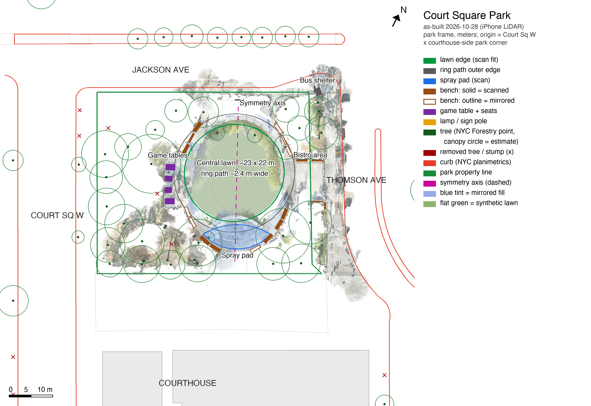

# Court Square Park / Long Island City

A fullscreen, interactive map of Long Island City, a 3D field-scan viewer and a LOD3 site model of Court Square Park. The map uses real NYC building footprints, roof heights and street geometry. The park stays highlighted in red and shows its as-built layout, measured from an iPhone LiDAR scan on October 28, 2026.

**Website:** https://ixthecreator.github.io/court-square-map/



## Use

- Drag to pan; Shift + drag to orbit. Scroll or use + / − to zoom.
- Select **LIC** for the full study area or **Park** for the park close-up. Zoomed in, the park shows the scanned lawn, ring path, spray pad, benches, game tables and trees.
- Move the height slider between flat footprints and the recorded roof heights.
- Select the red park or **Scan** to open the field scan. On a desktop-sized window it downloads automatically (150 MB). On phones, narrow windows or with Data Saver on, select **Load field scan**.
- **Symmetric fill** shows or hides the parts of the oval that were mirrored from the scanned side (see below).
- Select **Model** for the LOD3 site model built from the scan and NYC data (5 MB, loaded the first time you open it). One Court Square is left out of this view so it does not block the park; it is in the Rhino file. Drag to orbit, scroll or use + / − to zoom; the orientation button returns to the default view. The Rhino 8 file is in [`data/modeling/`](data/modeling/).
- Use the pin button to add an observation inside the park. In the scan, choose **Add note** and click a surface; notes on the field scan show latitude, longitude and height above grade.

Camera preferences, height settings, the symmetric-fill choice and up to 12 observation drafts are kept in this browser's local storage for the site. Clearing site data removes them.

## Field scan

| | |
|---|---|
| Captured | October 28, 2026, iPhone 16 Pro LiDAR, 3,385 keyframes |
| Model | 6,685,714 triangles, 3,438,352 vertices, 149.0 MB GLB 2.0 |
| Processing | TSDF fusion at 2 cm from high-confidence depth; vertex colour from the full-resolution camera frames; parked vehicles and floating specks removed; no decimation, no mesh or texture compression |
| Coordinates | Meters. Origin at the park corner where Court Square West meets the courthouse forecourt; +x along the courthouse edge toward Thomson Avenue, −z toward Jackson Avenue, y up from park grade |
| Registration | Fitted to the NYC Parks property line and NYC planimetric curbs; see [DATA_SOURCES.md](DATA_SOURCES.md) |

GitHub does not accept files over 100 MB, so [`scan/`](scan/) holds the GLB as four byte-exact parts, named with the file's hash so a cached older part can never be mixed into a newer scan. The page downloads them in parallel, checks the SHA-256 of the joined file against [`scan/manifest.json`](scan/manifest.json) and passes the original GLB to the viewer unchanged.

The model has two materials:

- `scan` holds the observed surfaces.
- `inferred` holds the oval ring mirrored across its symmetry axis (x ≈ 31.7 m, aligned with the courthouse entrance) wherever the scan did not reach, plus a flat fill for the unscanned lawn interior. Only the oval is mirrored. The rest of the park is not symmetric (the oval sits toward Thomson Avenue, with game tables to the west and the bistro area to the east), so it is shown as scanned.

## Import a scan

Choose **Scan → Import scan** (or **Replace scan**) and select a self-contained `.glb` file. There is no site size limit. Browsers can hold up to about 2 GB in one piece, and large models need a desktop GPU. The viewer requires embedded geometry and PNG/JPEG textures. Draco, KTX/Basis and Meshopt compression, external resources, `.gltf` bundles and ZIP archives are not accepted. Imported files stay in the current tab, are not uploaded, and are not georeferenced onto the city map.

## Data

Coverage follows the union of the 2020 NYC NTA areas **Long Island City–Hunters Point** and **Queensbridge–Ravenswood–Dutch Kills**, approximately 5.14 km². This is an explicit study-area definition, not a claim that LIC has one universally agreed boundary.

The embedded data snapshot contains **3,699 building footprints** and **1,213 street segments**, retrieved October 28, 2026. The park layer ([`data/park-detail.geojson`](data/park-detail.geojson)) combines features measured from the scan with NYC Forestry tree points. See [DATA_SOURCES.md](DATA_SOURCES.md) for sources, height interpretation, scan processing and limitations.

[`data/modeling/`](data/modeling/) is a modeling kit in the same park coordinates as the scan:

| File | Contents |
|---|---|
| `court_square_site_base.dxf` | Park property line, building footprints, curbs, sidewalks, roadbed, medians, trees with estimated canopies, spot elevations (layers, meters) |
| `court_square_scan_features.dxf` | Lawn oval, ring path, spray pad, benches (scanned and mirrored on separate layers), game tables, poles, symmetry axis |
| `court_square_park_LOD3.3dm` | Rhino 8 site model at LOD3, built from the scan measurements and NYC data: 457 objects on 44 layers. Ground follows the terrain fitted to NYC spot elevations, with 15 cm curbs, curb stones, tree pits, paving joints, groundcover beds and mulch rings. Furniture: 14 World's Fair benches (scanned and mirrored on separate layers), 4 game tables with chess boards, the lawn chain fence, the spear-top perimeter fence, lamp, signs, bus shelter and spray-pad drain. 69 trees shaped by species, each crown a single lobed surface. Buildings: 21 neighbours at LOD2 from the 2014 NYC 3D Building Model and 5 newer glass towers extruded with floor bands. The courthouse has its survey massing plus a LOD3 facade, entrance and roofs modelled from photos (on their own layers, marked approx). Earth anchor set to the park origin and true north |
| `court_square_park_LOD3_preview.glb` | The same model as a GLB (Y-up) for Cinema 4D, Blender or a web viewer |
| `court_square_park_LOD3_web.glb` | The copy the Model tab shows: the same GLB without One Court Square, with positions and normals quantized ([KHR_mesh_quantization](https://github.com/KhronosGroup/glTF/tree/main/extensions/2.0/Khronos/KHR_mesh_quantization)) to half the size. Use the preview GLB for modelling |
| `court_square_massing.obj` | Surrounding buildings extruded to recorded roof heights (Y-up) |
| `trees.csv`, `buildings.csv`, `scan_objects.csv` | Coordinate tables |

## Repository

| Path | Contents |
|---|---|
| `index.html` | The whole site: map, scan viewer, model viewer and embedded city data |
| `scan/` | Field-scan GLB parts and manifest |
| `data/` | Park layer, scan georeference, modeling kit |
| `docs/` | As-built plan image |
| `tools/split_scan.py` | Splits a GLB into parts and writes `scan/manifest.json` |
| `tools/scan-pipeline/` | Scripts that turn the raw LiDAR export into the registered mesh, plans and data (see its `run_all.sh`) |

To publish a new scan, export an uncompressed GLB in the same coordinates, then run:

```sh
python3 tools/split_scan.py new-scan.glb --name court-square-park-YYYY-MM-DD.glb --title "Court Square Park field scan" --captured YYYY-MM-DD --device "Device" --georef data/scan-georef.json
```

Commit the new parts and manifest. Notes made on the old scan stay attached to its filename, so keep the name when the geometry stays in the same coordinates.

## Run and publish

This is a static website. Serve the directory over HTTP, for example:

```sh
python -m http.server 8000
```

Open `http://localhost:8000`. No build step or API key is required. Internet access is needed to load the pinned D3 and model-viewer libraries and the icon runtime from their CDNs. A local copy loads the field scan from the published site, since the page's content security policy only allows downloads from `https://ixthecreator.github.io`. Browsers also block sandboxed pages from reaching `localhost`. Local imports work either way.

GitHub Pages publishes the repository root on **`main`**. `.nojekyll` enables direct static-file publishing.

Modern browsers with Canvas 2D, WebGL, `DecompressionStream` and Web Crypto are required.
